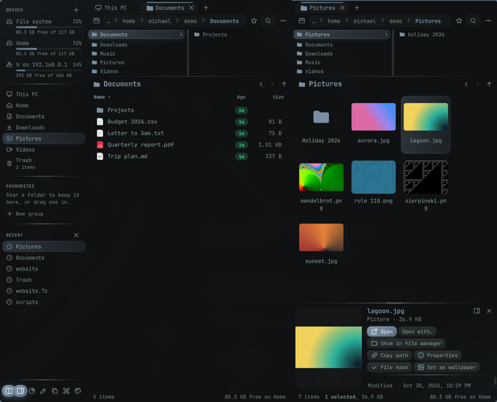
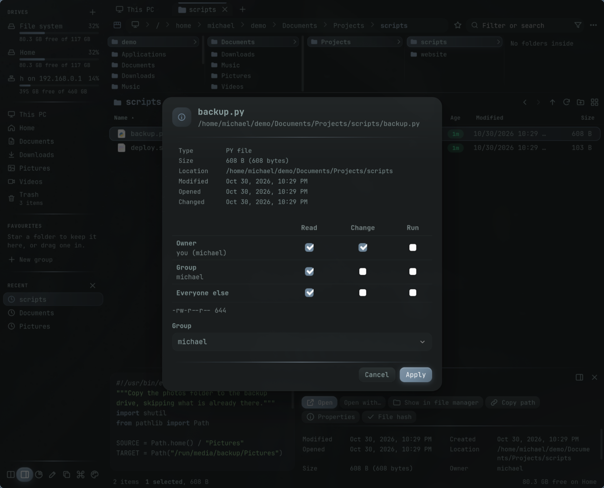
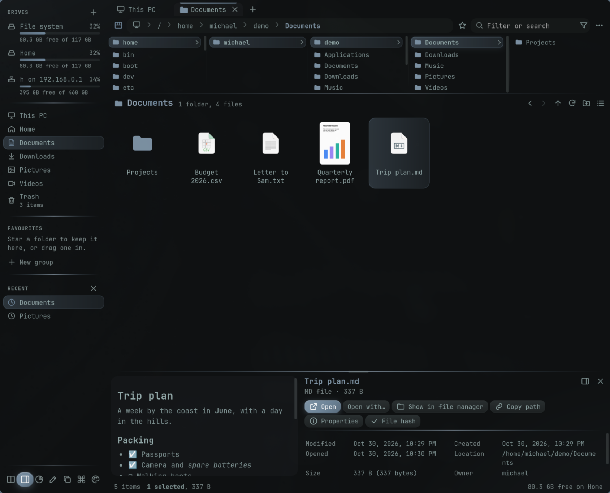
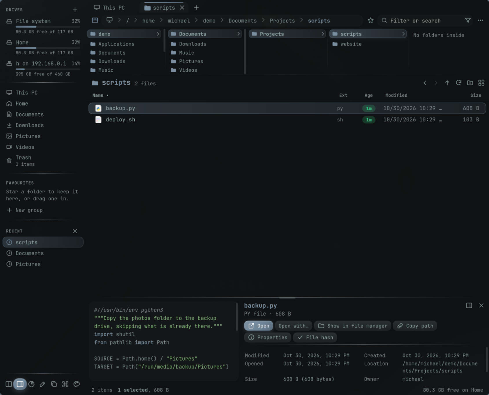
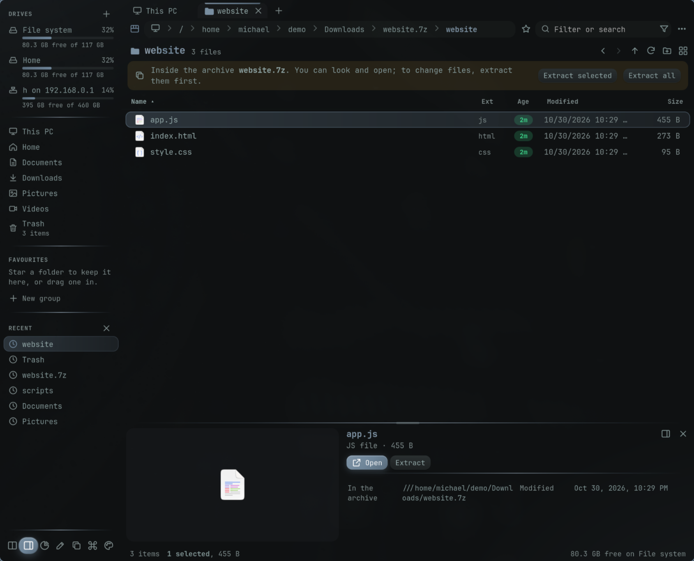
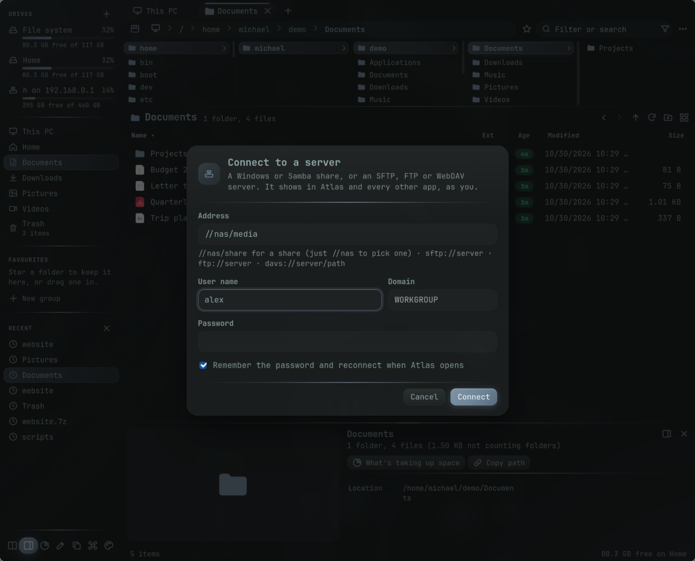
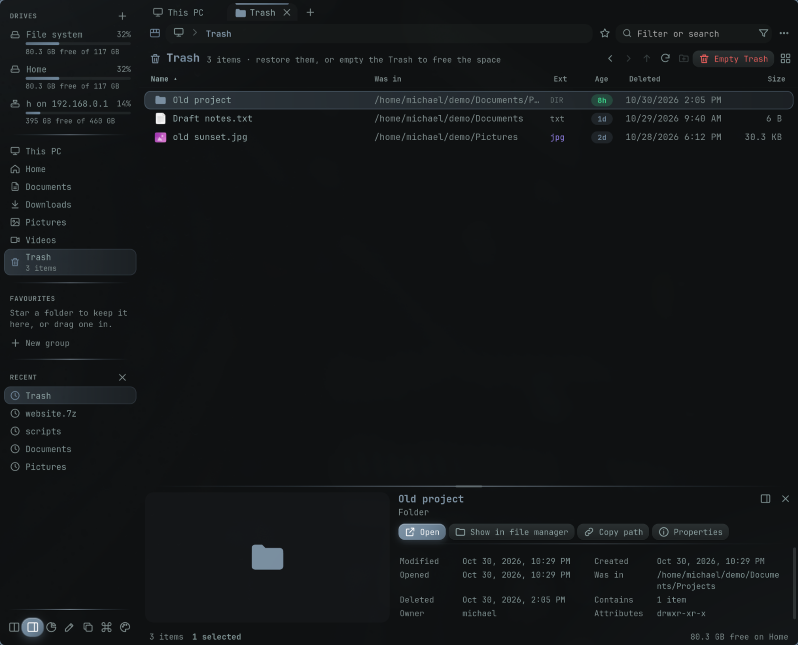

# Atlas for Linux

**A fast, keyboard-friendly file manager for Arch and Omarchy.** Tabs, two panes, folder columns, previews, archives, network shares and the Trash — in a window that follows your Omarchy theme and font.



Atlas began as a Windows file explorer (PowerShell + WebView2). This is its Linux version: the same page, hosted by Python, GTK 3 and WebKitGTK, and shipped as a small AppImage that uses your system's Python and WebKit.

## Features

### Finding your way
- **Tabs and two panes** side by side (Ctrl+\\), with each tab's history.
- **Folder columns** above the list, so you can see and jump anywhere along the path.
- **Details or tiles view**, sorting by name, type, age, date or size, and quick filters by kind, age and size.
- **Search** below the current folder (Enter in the filter box), with wildcards.
- **Go to (Ctrl+K)**: a command palette for every folder, drive, tab and action.
- **Favourites and groups** in the side bar, and your recent folders.
- **What's taking up space**: folder sizes, largest first.

### Files
- Copy and move with a queue you can pause, with progress and speed.
- Rename in place (F2), or many at once: find and replace, add text, number, change case or type.
- **Undo (Ctrl+Z)** for moves, copies, renames, new items, deletions and restores.
- **Properties**: owner, group, and read / change / run permissions, for one item or many, with "also change everything inside".
- **What's using it**: which programs have a file, folder or drive open, with a button to end them.
- File hashes, folder comparison, zip creation, and "Set as wallpaper" for images (Omarchy).



### Previews
- Photos, video thumbnails (ffmpegthumbnailer) and the first page of PDFs (poppler), in tiles and the preview pane.
- Video and audio playback, Office documents' text, Markdown rendered, and code in colour.

| | |
|---|---|
|  |  |

### Archives
Browse inside **zip, tar (.gz, .xz, .zst, .bz2), 7z, rar and iso** as if they were folders, and extract all or just what you select (bsdtar).



### Drives and network
- Drives with free space, **eject** for USB drives, and one click to open drives that are plugged in but not mounted.
- **Connect to a server**: Windows/Samba shares (`//nas/share`, or `//nas` to pick a share), **SFTP**, **FTP** and **WebDAV**, through GVFS — no root, no fstab. Passwords can be kept in the keyring, and remembered shares reconnect when Atlas opens.



### The Trash
One Trash view for your home Trash and every mounted drive's own, showing where each item was and when it was deleted, with Restore, Delete permanently and Empty Trash.



### Omarchy
- Follows the **Omarchy theme** (colours and folder icons) and **font**, live as you change them.
- Can be the **default file manager**: folders open in it, and "Show in folder" from browsers and other apps selects the file in Atlas.
- Ctrl+= / Ctrl+- / Ctrl+0 make everything bigger or smaller.

### Picking files for other apps
- Can be the **file picker** other apps use: "Open" and "Save as" in browsers, Flatpaks and other portal-aware apps bring up an Atlas window, with the app's file types to choose from.
- Double-click or Enter picks a file (a folder is gone into); when saving, clicking a file takes its name, and replacing one asks first. Escape or Cancel backs out.
- Each picker is its own window (class `dev.atlas.Atlas.Picker`), so your open Atlas is left alone. It starts in the folder the app gave, or the one you last picked from.

## Install

Download `Atlas-x86_64.AppImage` from the [latest release](https://github.com/kanibusrex/atlas-linux/releases/latest), then from a clone of this repo:

```sh
./install.sh ~/Downloads/Atlas-x86_64.AppImage            # app launcher entry
./install.sh ~/Downloads/Atlas-x86_64.AppImage --default  # ...and make it the default file manager
./install.sh ~/Downloads/Atlas-x86_64.AppImage --picker   # ...and the file picker other apps use
```

`--picker` registers Atlas with xdg-desktop-portal as its FileChooser (in `~/.local/share/xdg-desktop-portal/portals/atlas.portal`, and `org.freedesktop.impl.portal.FileChooser=atlas;gtk` in `~/.config/xdg-desktop-portal/<desktop>-portals.conf`). Chromium, Electron apps and Flatpaks use the portal already; GTK 3 apps need `GTK_USE_PORTAL=1` in their environment, GTK 4 apps `GDK_DEBUG=portals`, and Firefox `widget.use-xdg-desktop-portal.file-picker` = `1` in `about:config`. To undo it, delete that line from the portals.conf and restart `xdg-desktop-portal`.

Or just run the AppImage: `chmod +x Atlas-x86_64.AppImage && ./Atlas-x86_64.AppImage`.

### Requirements

```sh
sudo pacman -S python-gobject webkit2gtk-4.1
```

Optional, for the features that use them:

| Package | For |
|---|---|
| `libarchive` (bsdtar) | tar, 7z, rar and iso archives |
| `ffmpegthumbnailer` | video thumbnails |
| `poppler` | PDF previews |
| `gvfs-smb`, `smbclient` | Windows/Samba shares, and listing a server's shares |
| `gvfs-dnssd` | WebDAV |
| `gnome-keyring` | remembering network passwords |

### On Omarchy

A key to open (or focus) Atlas, in `~/.config/hypr/bindings.lua`:

```lua
o.bind("SUPER + A", "Atlas", "omarchy-launch-or-focus dev.atlas.Atlas \"uwsm-app -- " .. os.getenv("HOME") .. "/Applications/Atlas-x86_64.AppImage\"")
```

To try the picker without installing it: `python3 atlas.py --pick '{"mode": "open", "multiple": true}'` prints what you chose as JSON (`mode` is `open`, `save` or `savefiles`).

## Build

```sh
APPIMAGETOOL=/path/to/appimagetool ./build-appimage.sh   # writes dist/Atlas-x86_64.AppImage
```

Or run it straight from the source: `python3 atlas.py [folder]` (`ATLAS_DEBUG=1` prints the page's console).

| File | What it is |
|---|---|
| `atlas.py` | The window: GTK 3 + WebKitGTK, the bridge the page talks to, mounting, thumbnails, D-Bus |
| `atlas_core.py` | File operations: listing, search, copy, Trash, archives, permissions, network places |
| `atlas.html` | The whole interface |

Settings and the browser profile are kept in `~/.local/share/atlas`; thumbnails in `~/.cache/atlas/thumbs`.
